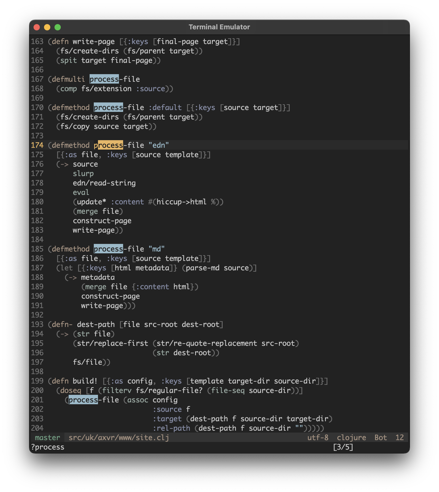

# Raider.vim

A Vim colour scheme for archaeological escapades.



(This Git repository is mirrored to
[Codeberg](https://codeberg.org/axvr/raider.vim),
[Sourcehut](https://git.sr.ht/~axvr/raider.vim) and
[GitHub](https://github.com/axvr/raider.vim).)


## Usage

Install this colour scheme using your preferred method, then place the
following lines in your Vim configuration.

```vim
set termguicolors
colorscheme raider
```

> [!NOTE]
> Raider.vim is a true-colour Vim theme.  If your terminal emulator does not
> support true/24-bit colours, the colours won't match those in the above
> screenshot.


## Ports

Ghostty, Alacritty and GNU Emacs ports of this theme can be found on the
[`ports` directory](https://codeberg.org/axvr/raider.vim/src/branch/master/ports).


## Attribution

Made possible thanks to Romain Lafourcade's [Vim-RNB](https://github.com/romainl/vim-rnb)
Vim colour scheme template.

Fallback xterm-256 colours were selected using [`colours.clj`](https://codeberg.org/axvr/archive/src/branch/master/2021/colours).


## Legal

*No Rights Reserved.*

All source code, documentation and associated files packaged with raider.vim are
dedicated to the public domain.  A full copy of the [CC0][] (Creative Commons
Zero 1.0 Universal) public domain dedication should have been provided with this
extension in the `COPYING` file.

The author is not aware of any patent claims which may affect the use,
modification or distribution of this software.

[CC0]: https://creativecommons.org/publicdomain/zero/1.0/
